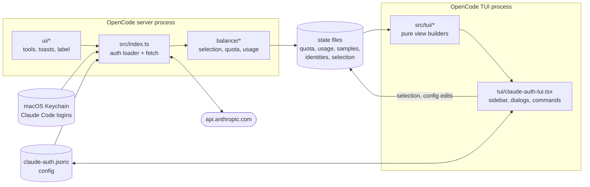
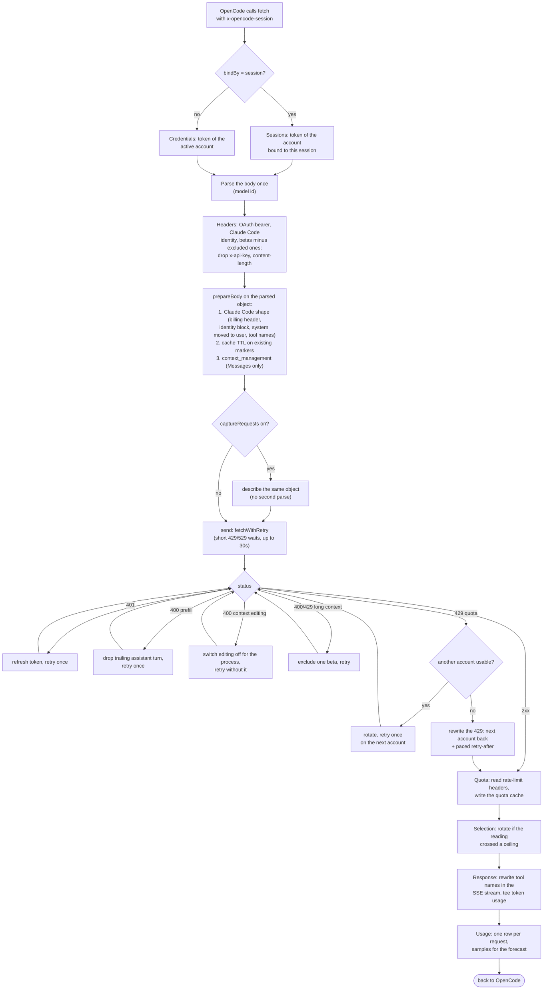
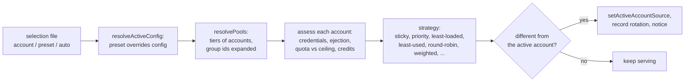
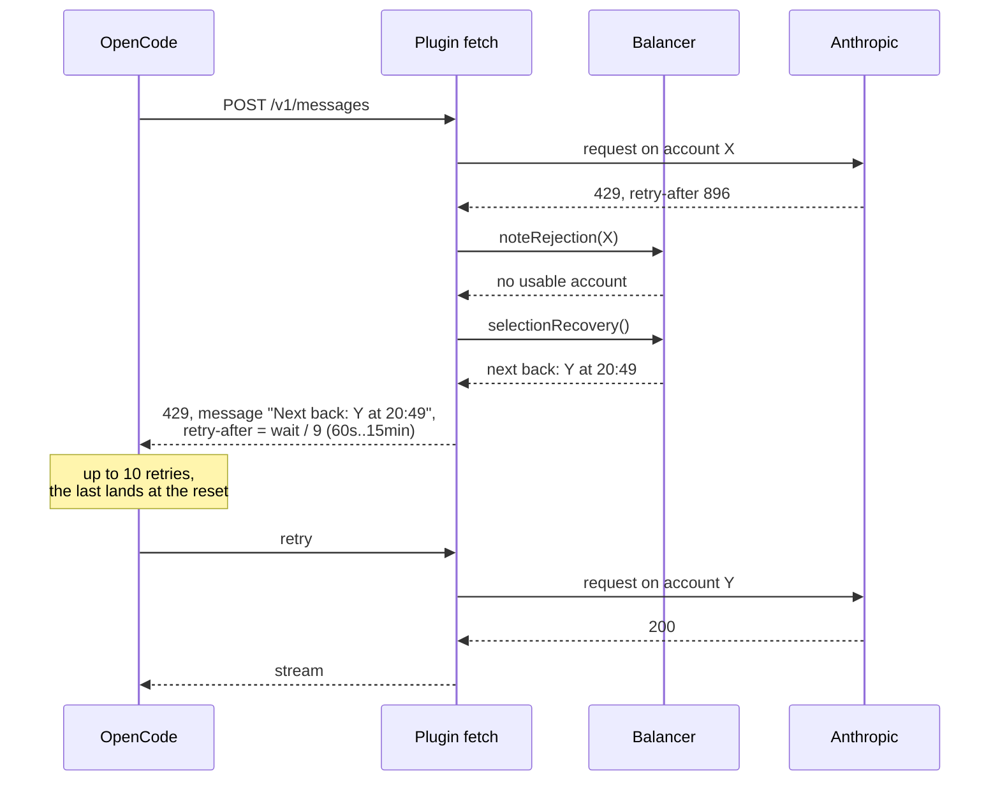
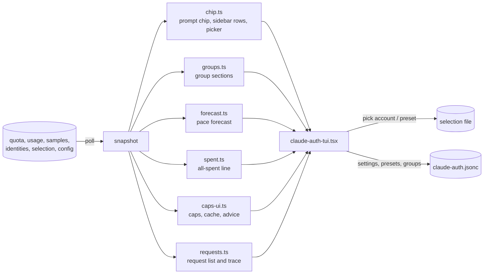

# Architecture

How the plugin is put together: the engines it is made of, the state they
share, and what happens to one request on its way to Anthropic and back.

Design decisions and their trade-offs are in [adr/](adr/README.md). Where each
fact is rendered in the TUI is in [src/tui/SURFACES.md](../src/tui/SURFACES.md).

## Two processes, one set of files

OpenCode runs the plugin twice: once in the server, which sends every model
request, and once in the TUI, which draws the sidebar, dialogs and commands.
They never call each other. They share state through files in
`~/.local/share/opencode/claude-auth/` and the config file, and each re-reads a file only
when it changed.

| File (under `~/.local/share/opencode/`)                              | Written by | Read by  | Holds                                                            |
| -------------------------------------------------------------------- | ---------- | -------- | ---------------------------------------------------------------- |
| `claude-auth/quota.json`                                             | server     | both     | latest 5h / weekly utilisation and reset per account id          |
| `claude-auth/usage.jsonl`                                            | server     | both     | one row per request: account, session, tokens, cache use         |
| `claude-auth/samples.jsonl`                                          | server     | TUI      | a week of utilisation samples, for the pace forecast             |
| `claude-auth/identities.json`                                        | both       | both     | account and org per Keychain entry (owner-only)                  |
| `claude-auth/selection.txt`                                          | both       | both     | the current selection: an account, a preset, or auto             |
| `claude-auth/reserve-allows.json`, `claude-auth/credit-denials.json` | both       | server   | per-session opt-ins to reserved quota and paid credits           |
| `claude-auth/tui-folds.json`                                         | TUI        | TUI      | which sidebar sections are collapsed                             |
| `claude-auth/requests.jsonl`                                         | server     | operator | request captures, only when `captureRequests` is on (owner-only) |

Read-modify-write of shared files holds a short lock
([ADR 0004](adr/0004-cross-process-file-locks.md)); frequent readers parse a file
only when its size or mtime changed (`balance/file-memo.ts`).

## Engines

Each engine decides in pure functions and acts in a thin shell, so the policy
is testable without a Keychain, a network or a clock.

| Engine               | Decides                                                                  | Main files                                                                                                  | State                                         |
| -------------------- | ------------------------------------------------------------------------ | ----------------------------------------------------------------------------------------------------------- | --------------------------------------------- |
| Credentials          | which Keychain logins exist, their tokens, refresh before expiry         | `credentials.ts`, `keychain.ts`, `refresh-lock.ts`                                                          | Keychain                                      |
| Identity             | the stable account/org pair behind each login                            | `balance/identity.ts`, `balance/accounts-id.ts`, `balance/account-key.ts`, `balance/migrate.ts`             | identities, config `accountIds`               |
| Selection (balancer) | which account serves the next request                                    | `balance/balancer.ts` (pure), `balance/rotate.ts` (applies), `balance/caps.ts`                              | selection file, config presets/groups/pools   |
| Sessions             | which account a given session is bound to; per-session opt-ins           | `balance/sessions.ts`                                                                                       | reserve/denial files                          |
| Quota                | each account's utilisation, from response headers                        | `balance/quota.ts`                                                                                          | quota cache                                   |
| Usage telemetry      | requests and tokens per account and session                              | `balance/usage.ts`, `balance/sse-usage.ts`, `balance/samples.ts`, `balance/cache-stats.ts`                  | usage log, samples                            |
| Request shaping      | turning OpenCode's request into one Anthropic accepts from Claude Code   | `request-body.ts`, `transforms.ts`, `signing.ts`, `betas.ts`, `model-config.ts`, `prefill.ts`               | none                                          |
| Cache and context    | cache TTL on existing markers; server-side context editing               | `balance/cache-ttl.ts`, `balance/context-edit.ts`                                                           | none                                          |
| Recovery             | what a refused request turns into: retry, rotate, or a paced "all spent" | `index.ts` (`fetchWithRetry`, `withSpentRetry`), `balance/rotate.ts` (`selectionRecovery`, `spentRetryNow`) | none                                          |
| Surfaces             | what the operator sees and can change                                    | `ui/*` (server), `src/tui/*` + `tui/*.tsx` (TUI), `config-edit.ts`                                          | config file                                   |
| Diagnostics          | logs, request captures, the debug block, the request trace               | `logger.ts`, `introspect.ts`, `tui/debug.ts`, `tui/requests.ts`                                             | log file, captures, `steps` on each usage row |

## One request

What `fetch` in `src/index.ts` does with a call to `/v1/messages`. Other
endpoints take the same path but get no context editing and no response
stream rewrite.

Every branch taken is recorded, in order, as `steps` on the request's usage
row (`bound`/`active`, `ttl-1h`, `ctx-edit`, `auth-401`, `prefill-trim`,
`ctx-off`, `beta-off`, `rotate`, `spent`, `status`). `/cc-requests` lists recent
requests and shows each one's path through this diagram.

Each recovery branch runs at most once per request. The order matters: a
request refused for prefill and then for context editing is retried with both
fixes ([ADR 0005](adr/0005-request-body-rewrites.md)).

## Choosing an account

The balancer is a pure function of the accounts, the quota cache, the config
and the time. `rotate.ts` calls it and applies the answer.

Rotation is checked on a timer, after every quota reading and on a 429. A pin
blocks it when `pinBlocksRotation` is on.

## When every account is spent

The sidebar shows the same answer ("all spent · next back Y at 20:49") from the
same function ([ADR 0003](adr/0003-spent-pool-retry-pacing.md)).

## The TUI

The TUI never talks to the server. It polls the state files, builds every view
in a pure function under `src/tui/`, and writes changes to the selection file
or the config file, which the server re-reads on its next request.

